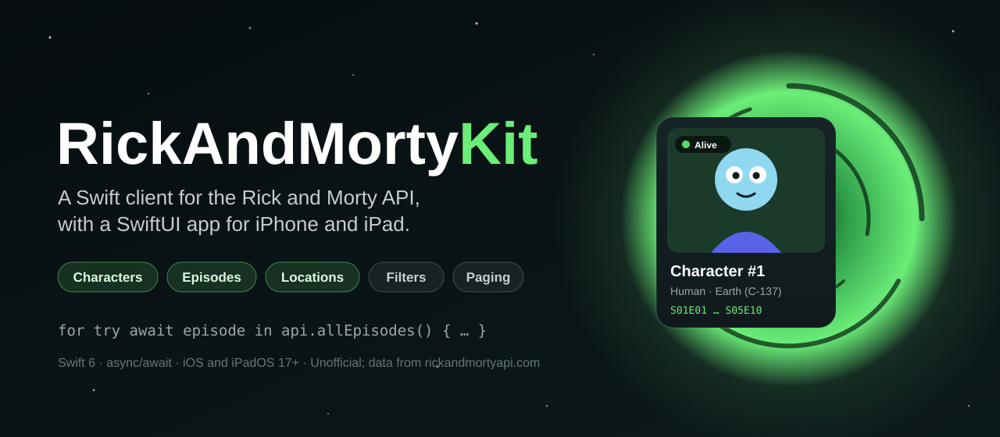
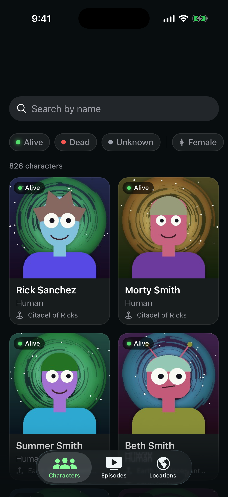
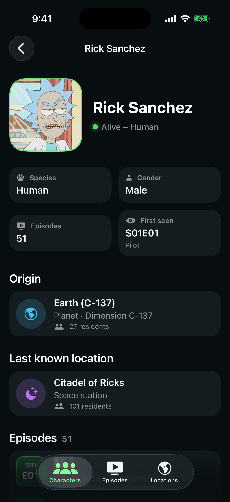
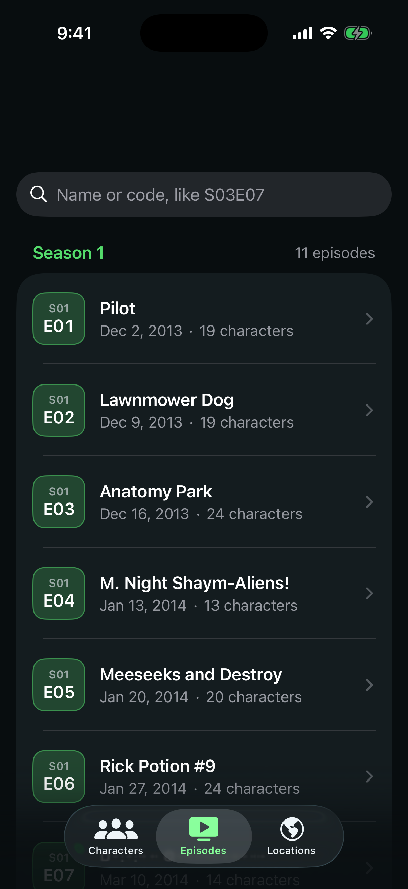
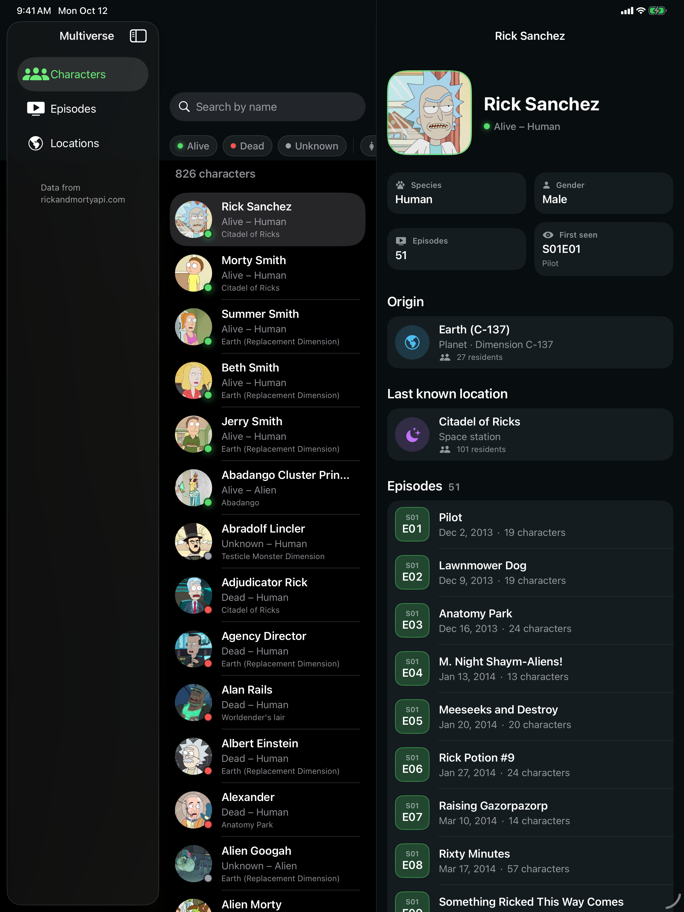

<p align="center">
  
</p>

<p align="center">
  <a href="https://github.com/halilozel1903/RickAndMortyKit/actions/workflows/ci.yml"></a>
  
  
  
  
  
  <a href="LICENSE"></a>
</p>

**RickAndMortyKit** is a Swift client for the free [Rick and Morty API](https://rickandmortyapi.com/documentation), with SwiftUI views and a demo app for **iPhone and iPad**. Characters, locations and episodes one by one, several by id, or a page at a time with every filter the API has; an `AsyncSequence` that walks every page for you; the resource URLs inside a model (a character's episodes, a location's residents) resolved in one request; parsed episode codes; and a small GraphQL helper. No API key, no dependencies.

```swift
import RickAndMortyKit

let api = RickAndMortyClient()

let rick = try await api.character(id: 1)
print(rick.name, rick.status, rick.origin.name)          // "Rick Sanchez" alive "Earth (C-137)"

let episodes = try await api.episodes(of: rick)          // [RMEpisode], one request
print(episodes.first?.code?.season ?? 0)                 // 1

let page = try await api.characters(filter: CharacterFilter(name: "smith", status: .alive))
print(page.info.count, page.results.map(\.name))

for try await episode in api.allEpisodes() {             // every page, loaded as you go
    print(episode.codeString, episode.name)              // "S01E01 Pilot"
}
```

## Screenshots

Captured by CI from the example app, *Multiverse*, on an iPhone and an iPad simulator, with real data and character images loaded live from [rickandmortyapi.com](https://rickandmortyapi.com): the first page of characters, Rick Sanchez's page and the episodes, starting with season 1.

| Characters | Character | Episodes |
| :---: | :---: | :---: |
|  |  |  |



## Features

- **The whole REST API**: characters, locations and episodes as lists with `info` (`count`, `pages`, `next`, `prev`), single resources, and several resources by id. See the table below.
- **Every filter**: `CharacterFilter` (name, status, species, type, gender), `LocationFilter` (name, type, dimension) and `EpisodeFilter` (name, episode code, or a whole season with `EpisodeFilter(season: 3)`). Blank filters are not sent, and `+` is encoded so the server doesn't read it as a space.
- **Multiple ids done right**: `/character/1,2,3` answers an array but `/character/1` answers an object; `characters(ids:)` reads both, keeps the order you asked for, drops duplicates and unknown ids, and splits long lists into several requests.
- **Paging as an `AsyncSequence`**: `characterPages()` yields every `Page` following `info.next`, `allCharacters()` yields every character, and `collect()` gathers them. Pages are always asked of your client's base URL, so this works behind a proxy or a stub. A filter with no matches (the API's 404 "There is nothing here") is an empty page, not an error.
- **Resource URLs resolved**: `episodes(of: character)`, `characters(in: episode)`, `residents(of: location)` and `location(character.origin)` each take one request, and `resource(at:)` loads any API URL such as `info.next`.
- **Typed models that match the JSON**: `RMCharacter`, `RMLocation` and `RMEpisode` (prefixed so they never shadow Swift's `Character`), with `CharacterStatus` and `CharacterGender` enums that read any case, `LocationReference` whose empty `url` is `nil`, `created` as a `Date` with milliseconds, and `air_date` readable as a `Date`. The models are `Codable` and encode back to the API's shape.
- **Episode codes**: `EpisodeCode("S03E07")` parses `season` and `episode` (any case, any number of digits), sorts, and prints back as `S03E07`. `groupedBySeason()` turns a list of episodes into seasons.
- **A small GraphQL helper**: `graphQL(_:variables:as:)` posts a query to `/graphql` with typed variables and decodes `data` into your own type; GraphQL errors are thrown with their messages.
- **Optional SwiftUI**: the `RickAndMortyUI` library has `CharacterCard` (tile and row, with a status dot), `EpisodeRow` with a season-colored code badge, `LocationCard`, `FilterBar` for status and gender, `StatusDot`, `StatusLine` and an avatar view with a swappable loader. The client works without it.
- **Testable and Swift 6 ready**: point the client at any `URLSession` and base URL. The package's own tests answer every request from a `URLProtocol` stub and hand-written fixtures, never the network. The client is `Sendable`; tested with Swift Testing on macOS and on an iOS simulator.

## API coverage

| Endpoint | Method |
| --- | --- |
| `GET /character?page=&name=&status=&species=&type=&gender=` | `characters(page:filter:)` → `Page<RMCharacter>` |
| `GET /character/:id` | `character(id:)` → `RMCharacter` |
| `GET /character/1,2,3` | `characters(ids:)` → `[RMCharacter]` |
| `GET /location?page=&name=&type=&dimension=` | `locations(page:filter:)` → `Page<RMLocation>` |
| `GET /location/:id` | `location(id:)` → `RMLocation` |
| `GET /location/1,2,3` | `locations(ids:)` → `[RMLocation]` |
| `GET /episode?page=&name=&episode=` | `episodes(page:filter:)` → `Page<RMEpisode>` |
| `GET /episode/:id` | `episode(id:)` → `RMEpisode` |
| `GET /episode/1,2,3` | `episodes(ids:)` → `[RMEpisode]` |
| every page of a list | `characterPages(filter:startingAt:)`, `locationPages`, `episodePages` → `PageSequence` |
| every item of a list | `allCharacters(filter:)`, `allLocations`, `allEpisodes` → `PagedItems` |
| a character's `episode` URLs | `episodes(of:)` → `[RMEpisode]` |
| an episode's `characters` URLs | `characters(in:)` → `[RMCharacter]` |
| a location's `residents` URLs | `residents(of:)` → `[RMCharacter]` |
| a character's `origin` or `location` | `location(_:)` → `RMLocation?` (`nil` when unknown) |
| any list of resource URLs | `characters(at:)`, `episodes(at:)`, `locations(at:)` |
| any API URL, such as `info.next` | `resource(at:as:)` |
| `POST /graphql` | `graphQL(_:variables:operationName:as:)` |
| anything else | `get(_:query:as:)` decodes any path into your own `Decodable` |

## Installation

In Xcode choose **File › Add Package Dependencies…** and enter:

```
https://github.com/halilozel1903/RickAndMortyKit
```

Or add it to `Package.swift`:

```swift
dependencies: [
    .package(url: "https://github.com/halilozel1903/RickAndMortyKit", from: "1.0.0")
],
targets: [
    .target(name: "MyApp", dependencies: [
        .product(name: "RickAndMortyKit", package: "RickAndMortyKit"),
        .product(name: "RickAndMortyUI", package: "RickAndMortyKit"),   // optional SwiftUI views
    ])
]
```

## Usage

### Characters, locations and episodes

```swift
let api = RickAndMortyClient.shared

let morty = try await api.character(id: 2)
morty.status                      // .alive
morty.gender                      // .male
morty.origin.isUnknown            // true: the API sends { "name": "unknown", "url": "" }
morty.location.id                 // 3, from the location's URL
morty.episodeIDs.count            // 51

let citadel = try await api.location(id: 3)
citadel.type                      // "Space station"
citadel.knownDimension            // nil: the API says "unknown"

let pilot = try await api.episode(id: 1)
pilot.codeString                  // "S01E01"
pilot.code                        // EpisodeCode(season: 1, episode: 1)
pilot.airDateValue                // December 2, 2013 as a Date (midnight UTC)
```

### Pages and filters

```swift
let page = try await api.characters(page: 2, filter: CharacterFilter(species: "Alien", gender: .genderless))
page.info.count                   // results on every page
page.info.pages                   // number of pages
page.info.next                    // URL?, nil on the last page
page.number                       // 2
page.hasNextPage

let planets = try await api.locations(filter: LocationFilter(type: "Planet", dimension: "C-137"))
let season3 = try await api.episodes(filter: EpisodeFilter(season: 3))          // ?episode=S03
let one = try await api.episodes(filter: EpisodeFilter(code: EpisodeCode(season: 1, episode: 5)))

let nobody = try await api.characters(filter: CharacterFilter(name: "zzzz"))
nobody.isEmpty                    // true: no matches is an empty page, not an error
```

### Every page as an AsyncSequence

```swift
for try await page in api.characterPages(filter: CharacterFilter(status: .dead)) {
    print("page \(page.number) of \(page.info.pages)", page.results.count)
}

for try await location in api.allLocations(filter: LocationFilter(type: "Planet")) {
    print(location.name)
}

let everyEpisode = try await api.allEpisodes().collect()
for season in everyEpisode.groupedBySeason() {
    print("Season \(season.season):", season.episodes.map(\.name))
}
```

Pages load one at a time as you iterate, so breaking out of the loop stops the requests. Cancelling the task stops them too.

### Several by id, and resource URLs

```swift
let family = try await api.characters(ids: [1, 2, 3, 4, 5])   // one request, in this order
let one = try await api.characters(ids: [1])                  // the API answers an object; still an array

let rick = family[0]
let rickEpisodes = try await api.episodes(of: rick)           // /episode/1,2,3,…
let origin = try await api.location(rick.origin)              // RMLocation?, nil for "unknown"
let cast = try await api.characters(in: rickEpisodes[0])      // /character/1,2,…
let earth = try await api.location(id: 1)
let residents = try await api.residents(of: earth)           // one request for every resident

let next = try await api.resource(at: page.info.next!, as: Page<RMCharacter>.self)
```

### Episode codes

```swift
let code = EpisodeCode("S03E07")!     // also "s3e7" or "S10E120"
code.season                           // 3
code.episode                          // 7
code.seasonCode                       // "S03", what the episode filter takes for a season
code.description                      // "S03E07"
EpisodeCode("Pilot")                  // nil
```

### GraphQL

```swift
struct Result: Decodable {
    struct Characters: Decodable { let results: [Item] }
    struct Item: Decodable { let id: String; let name: String; let status: CharacterStatus }
    let characters: Characters
}

let result = try await api.graphQL(
    """
    query($page: Int, $filter: FilterCharacter) {
      characters(page: $page, filter: $filter) { results { id name status } }
    }
    """,
    variables: ["page": 1, "filter": ["name": "rick", "status": "alive"]],
    as: Result.self
)
```

GraphQL ids are strings. A response with `errors` throws `RickAndMortyError.graphQL(messages)`.

### Errors

```swift
do {
    _ = try await api.character(id: 9999)
} catch let error as RickAndMortyError {
    switch error {
    case .notFound(let message, _): print(message ?? "")    // "Character not found"
    case .http(let status, let message, _): break
    case .decoding(let type, let description): break
    case .transport(let urlError): break                    // offline, timed out, cancelled
    case .invalidResponse: break
    case .graphQL(let messages): break
    }
}
```

### Testing your code

The client talks to whatever `URLSession` and base URL you give it, so tests can stub every response:

```swift
let configuration = URLSessionConfiguration.ephemeral
configuration.protocolClasses = [MyStubProtocol.self]

let client = RickAndMortyClient(configuration: RickAndMortyConfiguration(
    baseURL: URL(string: "https://stub.test/api")!,
    session: URLSession(configuration: configuration)
))
```

The models are `Codable`, so you can also decode recorded JSON directly: `try JSONDecoder().decode(Page<RMCharacter>.self, from: data)`.

### SwiftUI views

```swift
import RickAndMortyKit
import RickAndMortyUI

@State private var filter = CharacterFilter()

// Status and gender chips; tap again to clear.
FilterBar(status: $filter.status, gender: $filter.gender)

// A square tile for grids, or a row for lists, with the status dot.
LazyVGrid(columns: [GridItem(.adaptive(minimum: 160))]) {
    ForEach(characters) { CharacterCard(character: $0) }
}
CharacterCard(character: rick, style: .row)

// The code badge, name, air date and number of characters.
EpisodeRow(episode: pilot)

// The name, type, dimension and number of residents, with a symbol for the type.
LocationCard(location: citadel)

// The dot alone, or with "Alive – Human".
StatusDot(.alive)
StatusLine(rick)
```

Avatars load through `RickAndMortyImage`, which uses the `RickAndMortyImageLoader` in the environment (by default `URLSession` with an in-memory cache) and shows a gradient with initials until the image arrives. Swap the loader for your own cache, or for bundled artwork in previews:

```swift
ContentView()
    .rickAndMortyImageLoader(RickAndMortyImageLoader { url in
        try await MyImageCache.shared.data(for: url)
    })
```

## Example app

The `Example` folder contains *Multiverse*, built with RickAndMortyKit and RickAndMortyUI:

- **iPhone**: tabs for characters, episodes and locations. The character grid has search and status and gender filters and loads the next page as you scroll; a character's page shows the origin, the last known location and every episode; episodes are grouped by season; every page links to the others.
- **iPad**: a `NavigationSplitView` with a sidebar (Characters, Episodes, Locations), the list in the middle column and the selection's page in the detail column.

The project uses [XcodeGen](https://github.com/yonaskolb/XcodeGen) so no project file has to live in the repo:

```bash
brew install xcodegen
cd Example && xcodegen generate
open RickAndMortyDemo.xcodeproj
```

Run `RickAndMortyDemo` on an iPhone or iPad simulator. The app always uses the live API. Launch with `-screenshot characters|character|episodes` (iPhone) or `-screenshot browser` (iPad) to open a fixed scene, as CI does for the screenshots above.

## Trademark and data

Rick and Morty is a trademark of its owners. RickAndMortyKit is an unofficial, fan-made client and is not affiliated with or endorsed by them or by the API's authors. The data comes from [rickandmortyapi.com](https://rickandmortyapi.com), a free community API; please be kind to it and cache what you can.

The character images in the app and in the README screenshots are loaded from rickandmortyapi.com and belong to their owners; apart from the screenshots, no artwork from the show is stored in this repository, and the app icon is original artwork made for the demo. The JSON fixtures used by the unit tests are hand-written in the API's shapes.

## Requirements

- Xcode 26 or later (Swift 6.2 toolchain)
- iOS 17+ and iPadOS 17+ (macOS 14+ for running the tests and using the client on the Mac)

## Contributing

Issues and pull requests are welcome. Please run the tests before opening a PR:

```bash
swift test
bash scripts/test.sh iOS
```

## License

RickAndMortyKit is available under the MIT license. See [LICENSE](LICENSE).
